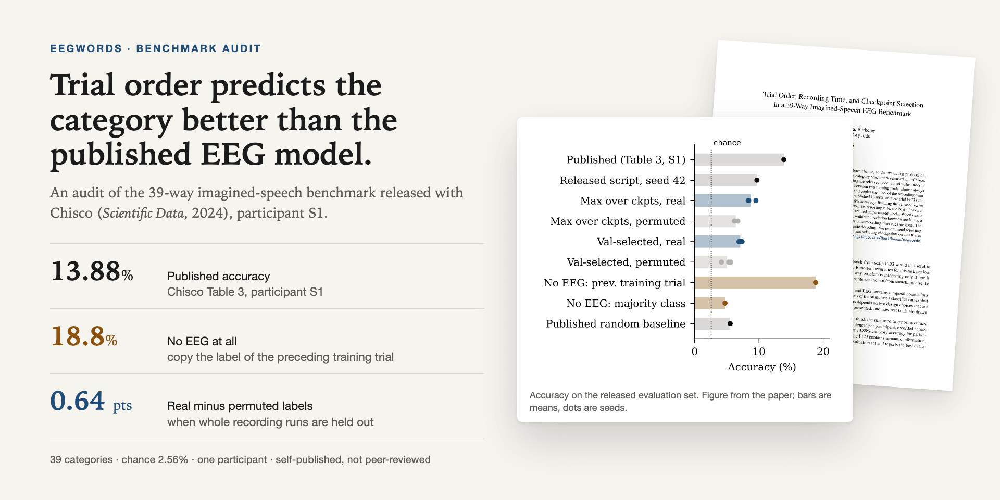
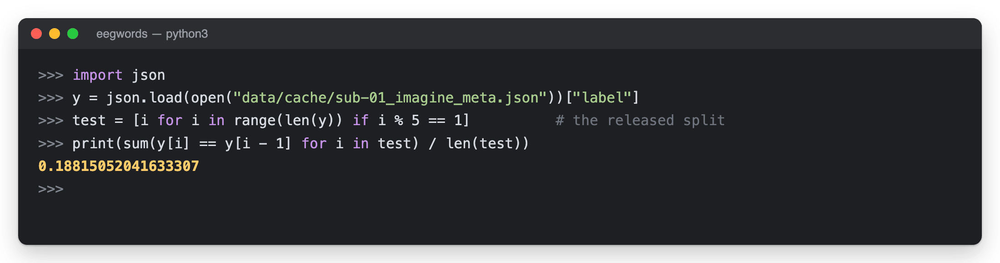
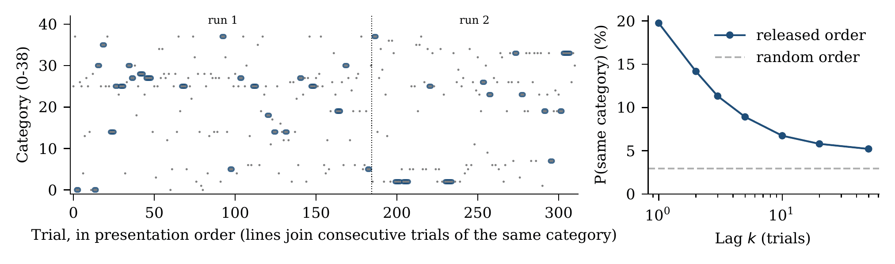
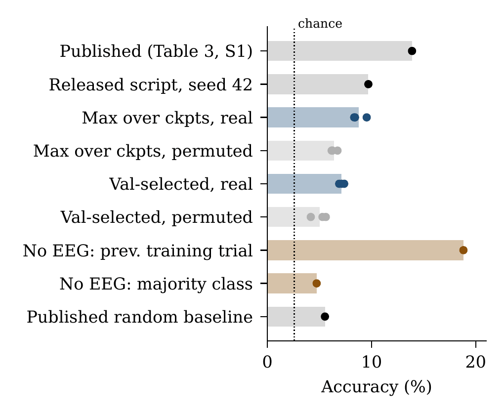
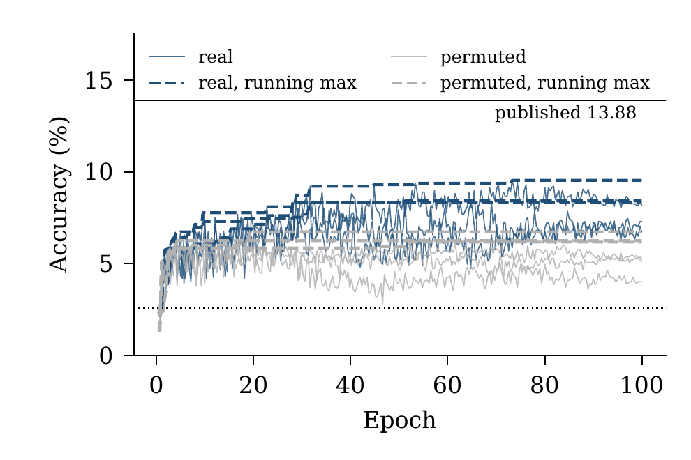
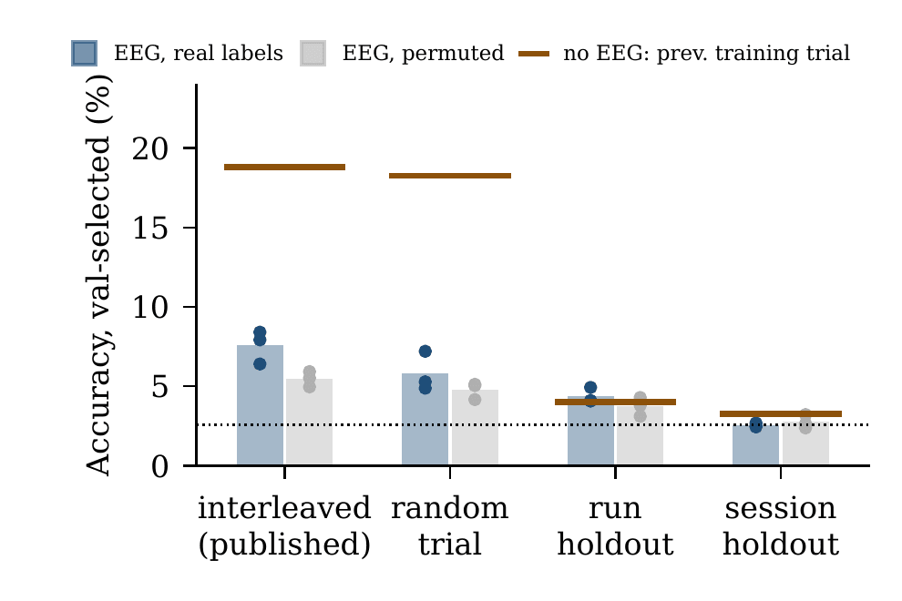
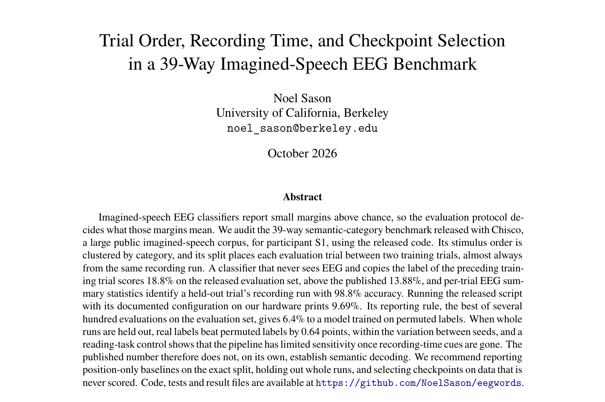
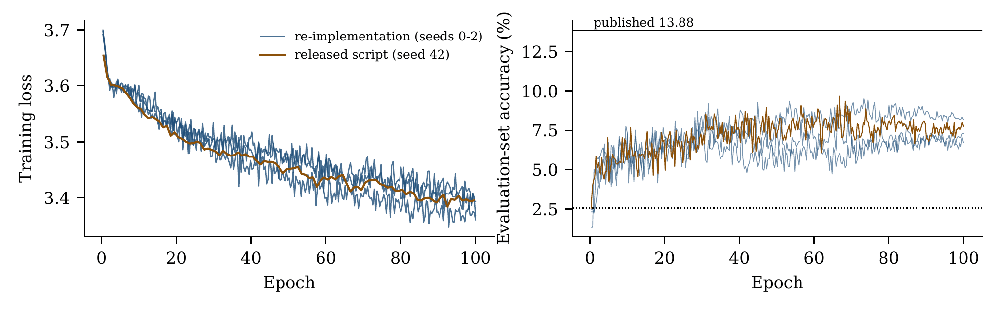
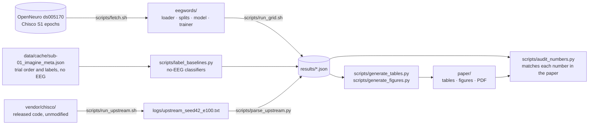

<p align="center">
  
</p>

<p align="center">
  <b>Trial order, recording time, and checkpoint selection in a 39-way imagined-speech EEG benchmark.</b><br>
  An audit of the benchmark released with Chisco (<i>Scientific Data</i>, 2024). On the released split, a classifier that never sees EEG beats the published result.
</p>

<p align="center">
  
  
  
  
  
  
  <a href="paper/Sason_2026_imagined_speech_eeg_audit.pdf"></a>
  
</p>

<p align="center">
  <a href="#findings">Findings</a> ·
  <a href="#quick-check">Quick check</a> ·
  <a href="#how-the-audit-works">How the audit works</a> ·
  <a href="#whats-here">What's here</a> ·
  <a href="#reproduce">Reproduce</a> ·
  <a href="#known-limitations">Limitations</a> ·
  <a href="#citation">Citation</a>
</p>

> [!IMPORTANT]
> The paper is self-published and has not been peer-reviewed. All EEG results are for one participant (S1). The results show what this benchmark, as released, cannot establish. They do not show that the EEG has no semantic content.

**Paper:** [Sason_2026_imagined_speech_eeg_audit.pdf](paper/Sason_2026_imagined_speech_eeg_audit.pdf) ·
also at [noelsason.com/work](https://noelsason.com/work#imagined-speech-eeg-audit)

This repository contains the code, every result file, and the evidence trail behind the paper.

## Why

Imagined-speech EEG classifiers report small margins above chance, so the evaluation protocol decides what those margins mean. [Chisco](https://doi.org/10.1038/s41597-024-04114-1) is a large public imagined-speech corpus: over 6,000 sentences per participant, recorded across five days and labeled with 39 semantic categories. Its authors report 13.88% category accuracy for participant S1, against a 5.52% shuffled-label baseline. The released code puts every fifth trial, in recording order, into the evaluation set and reports the best evaluation accuracy seen during training.

EEG trials recorded close together resemble each other regardless of the stimulus, so a classifier can learn *when* a trial was recorded instead of *what* was imagined. This audit asks how much of the published number that alone can explain.

## Findings

Participant S1, 39 categories, chance 2.56%.

| | Accuracy |
|---|---|
| Published result (Chisco Table 3) | 13.88% |
| **No EEG:** copy the label of the preceding training trial | **18.82%** (95% CI 16.49–21.57) |
| Released script, documented configuration, our hardware | 9.69% |
| Re-implementation, published reporting rule (3 seeds) | 8.75% ± 0.67 |
| Same, trained on permuted labels | 6.38% ± 0.30 |
| Real − permuted, released split / **whole runs held out** | 2.11 / **0.64** points |

- The released stimulus order is clustered by category (19.7% of consecutive trials share one; 2.95% if shuffled), and the released split puts every evaluation trial between training trials from the same run.
- Per-trial EEG summary statistics identify a held-out trial's recording run with 98.8% accuracy, which gives a model the information it needs to exploit that order.
- The released code reports the best of 313 evaluations on its only evaluation set.
- When whole runs are held out, the real-vs-permuted margin falls within seed variation. A reading-task control shows the pipeline has limited sensitivity once those cues are gone.

## Quick check

The headline number needs no EEG. It takes three lines, using only the released trial order and labels.

<p align="center">
  
</p>

<sub>A real Python session run from the repository root. `data/cache/sub-01_imagine_meta.json` ships with the repo; it holds the released trial order and labels, and no EEG.</sub>

```python
import json
y = json.load(open("data/cache/sub-01_imagine_meta.json"))["label"]
test = [i for i in range(len(y)) if i % 5 == 1]          # the released split
print(sum(y[i] == y[i - 1] for i in test) / len(test))   # 0.188
```

## How the audit works

<p align="center">
  
</p>

**1. The stimulus order is clustered by category.** Left: the category of each trial in runs 1 and 2, in presentation order; lines join consecutive trials of the same category. Right: the chance that two trials *k* positions apart share a category, against the value for a random order (dashed). At lag 1 it is 19.7%, against 2.95%.

<table>
  <tr>
    <td width="50%"></td>
    <td width="50%"></td>
  </tr>
  <tr>
    <td valign="top"><b>2. Trial position alone beats the published number.</b> Copying the previous training trial's label scores 18.8% (brown). The released script printed 9.69%, and the re-implementation scores 8.75% under the published rule. Bars are means; dots are seeds.</td>
    <td valign="top"><b>3. The reporting rule inflates every run.</b> Accuracy at each of the 281 evaluations of the published configuration, with running maxima (dashed). The published rule reports where the dashed line ends. It adds 1.6 points to real labels and 1.4 to permuted labels over a validation-selected checkpoint.</td>
  </tr>
  <tr>
    <td width="50%"></td>
    <td width="50%"><a href="paper/Sason_2026_imagined_speech_eeg_audit.pdf"></a></td>
  </tr>
  <tr>
    <td valign="top"><b>4. Holding out whole runs removes most of the margin.</b> Under run holdout, real labels score 4.37% and permuted labels 3.73%, a 0.64-point gap within seed variation. Brown lines show the no-EEG classifier on the same evaluation folds.</td>
    <td valign="top"><b>5. Read the paper.</b> 14 pages: the no-EEG audit, a re-run of the released script, three selection rules, the split comparison, a reading-task control, and limitations. <a href="paper/Sason_2026_imagined_speech_eeg_audit.pdf">Open the PDF</a>.</td>
  </tr>
</table>

<sub>Figures are rendered from the PDFs in `paper/figures/`, which `scripts/generate_figures.py` builds from `results/`.</sub>

<details>
<summary>Check: the re-implementation tracks the released script</summary>

<p align="center">
  
</p>

Same configuration (500 Hz, 100 epochs, released split). Per-epoch training loss differs from the released script's by at most 0.043 (mean 0.016) across three seeds, and the evaluation curves overlap. Neither reaches 13.88%.

</details>

### What the paper recommends

For benchmarks where trials are recorded in a fixed order:

1. Report a classifier that uses only trial position and training labels, on the exact evaluation split. It costs seconds and bounds how much the split leaks.
2. Hold out whole runs or sessions when stimulus order is not fully randomized, and say which. Check that held-out units have the same label distribution, or report that they don't.
3. Select checkpoints and hyperparameters on data that is never used for the reported number, and report how many evaluations the selection saw.
4. Run the shuffled-label baseline through the identical pipeline, including the selection rule, and report it next to the main number.
5. Release the trial order and the split indices with the data.

## What's here



Every number in the paper is read from a file under `results/` by a script in `scripts/`. The only values typed in by hand are the published ones from Chisco Table 3.

| Path | Contents |
|---|---|
| `paper/` | LaTeX source, figures, generated tables, and the [PDF](paper/Sason_2026_imagined_speech_eeg_audit.pdf). [`paper/README.md`](paper/README.md) maps every table and figure to the script and file that produce it. |
| `results/` | One JSON per EEG configuration and seed (see the following section), plus the no-EEG baselines, drift probe, per-trial prediction analysis, checkpoint analysis, `summary.json`, and `number_audit.json`. |
| `results/superseded_evalmode_bug/` | First-pass runs voided by a training bug (found and fixed; see `research_audit/`). Kept for transparency, not used. |
| `eegwords/` | Data loader (follows the released code's trial order and label mapping), splits, model, trainer, no-EEG baselines. |
| `scripts/` | Download, grid runner, the released-script runner, analyses, table and figure generation, number audit. |
| `tests/` | Split integrity, model equivalence, trainer regression tests. |
| `vendor/chisco/` | The authors' code, unmodified (MIT), commit `e051c5b`. |
| `logs/` | Output of the released script (`upstream_seed42_e100.txt`) and the two changes made to run it (`upstream_patch.diff`). |
| `sources/` | Full text of the Chisco paper (Europe PMC XML) and the upstream commit hash. |
| `research_audit/` | Evidence ledger, experiment inventory, claim matrix, original-paper audit, reviewer objections, and a claim-by-claim trace of every number in the paper. |
| `docs/media/` | Images for this README. |

### Result files

`results/{task}_full_{rate}hz_{split}_{labels}_e{epochs}_seed{n}.json`

- `task`: `imagine` or `read` (reading-epoch control)
- `split`: `interleaved` (released rule `index % 5 == 1`), `random_trial`, `run_holdout`, or `session_holdout`
- `labels`: `real` or `perm` (training labels permuted; evaluation labels intact)

Each file stores the config, and for every fold the validation and test accuracy at each of the
~280 evaluations, the test predictions at three checkpoints, and accuracy under three selection
rules: `upstream_max` (best evaluation, the published rule), `val_selected` (checkpoint chosen on
held-out validation data), and `final`.

## Reproduce

You need Python 3.12, [uv](https://docs.astral.sh/uv/), and about 26 GB of disk for the public
data. The runs were developed on an Apple-silicon laptop (PyTorch MPS); CUDA and CPU also work.

```bash
uv sync
scripts/fetch.sh imagine && scripts/fetch.sh read    # public data from OpenNeuro ds005170
uv run --with pytest pytest tests -q                 # 13 tests

# minutes, from existing results/ (no training)
uv run python scripts/label_baselines.py
uv run python scripts/generate_tables.py
uv run python scripts/generate_figures.py
uv run python scripts/audit_numbers.py

# everything from scratch (~12 h of GPU time)
scripts/reproduce_main_results.sh
```

To rebuild the PDF, run `tectonic -X compile main.tex` in `paper/`.

## Known limitations

These are summarized from the paper's Limitations section.

- **One participant.** All EEG results are for S1. Chisco reports S2 and S3 at 13.59% and 14.02%; this audit doesn't cover them.
- **One model family and preprocessing.** A different architecture, frequency band, or artifact treatment could find semantic information that this pipeline doesn't.
- **Not the authors' environment.** The released configuration ran on Apple-silicon GPUs with these seeds. The audit can't rule out that the authors' exact run reached 13.88%.
- **Two schedules.** The split comparison uses 250 Hz and 30 epochs to fit on one machine, and is compared only within itself.
- **Three seeds.** With three seeds per cell, the paper reports means, standard deviations, and per-seed values, not significance tests.
- **Overlap with concurrent work.** A public code release audits stimulus-order and run-identity confounds in Chisco's sentence-level decoding. The paper cites it as software.

## Data

The data are Chisco, [OpenNeuro ds005170](https://openneuro.org/datasets/ds005170)
(doi:10.18112/openneuro.ds005170.v1.1.2), released under CC0 by Zhang, Zhao, Bao and Ding. This
repository redistributes no EEG; `scripts/fetch.sh` downloads it from the public bucket.

## Citation

```bibtex
@misc{sason2026chiscoaudit,
  title  = {Trial Order, Recording Time, and Checkpoint Selection in a 39-Way
            Imagined-Speech {EEG} Benchmark},
  author = {Sason, Noel},
  year   = {2026},
  note   = {\url{https://noelsason.com/papers/sason-2026-imagined-speech-eeg-audit.pdf}}
}
```

Also cite the dataset: Zhang et al., *Chisco: An EEG-based BCI dataset for decoding of
imagined speech*, Scientific Data 11, 1265 (2024).

## License

Code: MIT (see `LICENSE`). `vendor/chisco/` keeps its original MIT license. The paper is © 2026
Noel Sason.

## AI assistance

Most of the analysis code and the paper's first draft were written with Claude (Anthropic) under
the author's direction; the paper's "Use of AI assistance" section gives the details.
